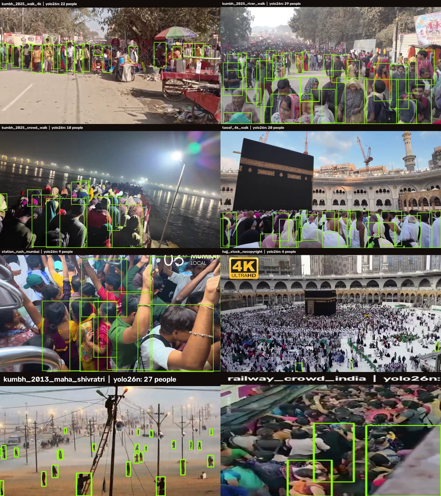

# Test footage — pilgrim and mass-gathering crowds

Real crowds, not synthetic. Fifteen clips live in `.data/samples/pilgrim/` (70 MB, all on D:)
and are selectable in the dashboard's *Add camera* picker under the **Pilgrim** group.

Re-fetch, extend or repair the set with:

```bash
./.venv/Scripts/python.exe backend/tools/fetch_footage.py            # fetch what is missing
./.venv/Scripts/python.exe backend/tools/fetch_footage.py --list     # what is already here
./.venv/Scripts/python.exe backend/tools/fetch_footage.py --only tawaf_4k_walk
```

Every clip is trimmed to 45 s (25 fps, ≤ 1280 px wide, no audio, H.264 CRF 27) so the whole
library stays small and starts instantly. Provenance and licence for each file are in
`.data/samples/pilgrim/manifest.json`.

## What is in the set

| Clip | Source | Resolution | Licence | Scene |
|---|---|---|---|---|
| `kumbh_2025_walk_4k` | [YouTube 7PL06-02P-o](https://www.youtube.com/watch?v=7PL06-02P-o) | 1280×676 | evaluation only | Maha Kumbh 2025 walking tour, dense one-way flow |
| `kumbh_2025_river_walk` | [YouTube CtmghCnDEhU](https://www.youtube.com/watch?v=CtmghCnDEhU) | 1280×720 | evaluation only | Mauni Amavasya walk to the river, packed shoulder to shoulder |
| `kumbh_2025_crowd_walk` | [YouTube sIXvtuVBQ-4](https://www.youtube.com/watch?v=sIXvtuVBQ-4) | 1280×720 | evaluation only | Night riverside crowd, head-coverings and saris |
| `tawaf_4k_walk` | [YouTube 5Z0OMaVL1T4](https://www.youtube.com/watch?v=5Z0OMaVL1T4) | 1280×720 | evaluation only | Kaaba tawaf, continuous circular mass |
| `station_rush_mumbai` | [YouTube DTCQU72cHa4](https://www.youtube.com/watch?v=DTCQU72cHa4) | 1280×720 | evaluation only | Mumbai platform at 8 pm, crushing queue density |
| `hajj_stock_nocopyright` | [YouTube 9gJRP_vQjO4](https://www.youtube.com/watch?v=9gJRP_vQjO4) | 1280×720 | uploader claims no-copyright (unverified) | Aerial Haram, tens of thousands in one frame |
| `kumbh_ardh_2007_street` | [Archive.org](https://archive.org/details/SapnaShahaniArdhKumbhMela) | 640×426 | **CC BY 2.0** | Ardh Kumbh ghats and approach roads |
| `kumbh_ardh_2007_ghat` | [Archive.org](https://archive.org/details/SapnaShahaniArdhKumbhMela2007_0) | 640×426 | **CC BY 2.0** | Standing crowd at the river bank |
| `kumbh_ardh_2007_procession` | [Archive.org](https://archive.org/details/SapnaShahaniArdhKumbhMela2007_1) | 426×240 | **CC BY 2.0** | Procession, moving dense crowd |
| `kumbh_ardh_2007_camp` | [Archive.org](https://archive.org/details/Swajana-ArdhKumbhMela2007549) | 320×240 | CC BY-NC 2.0 | Camp / queue area, slow dense movement |
| `kumbh_2013_maha_shivratri` | [Archive.org](https://archive.org/details/NagaSadhusInKumbhMela2013MahaShivaratri) | 640×360 | not stated | 2013 bathing crowd, elevated wide view |
| `railway_crowd_india` | [Archive.org](https://archive.org/details/india-railways-crowd-bharat-civic-sense) | 320×400 | not stated | Overhead platform crowd |
| `tawaf_kaaba_a` | [Archive.org](https://archive.org/details/youtube-gN7u50CTCCQ) | 320×240 | not stated | Tawaf, circular dense crowd |
| `tawaf_kaaba_b` | [Archive.org](https://archive.org/details/youtube-mlWf0H-_gC4) | 270×480 | not stated | Tawaf, oblique phone angle |
| `tawaf_kaaba_c` | [Archive.org](https://archive.org/details/youtube-51-LDbF7OFc) | 270×480 | not stated | Tawaf, wider shot |

**Licence discipline.** Only the four `kumbh_ardh_2007_*` Archive.org items carry a Creative
Commons licence (one is non-commercial). Everything from YouTube is marked *evaluation only*:
fine for local testing and bench-marking, not for redistribution, a public demo, or training
data. If this footage ever goes in front of an audience, replace those clips with the CC-BY
items or licensed stock.

## What the detector actually does on this footage

YOLO26n at `imgsz=1280`, `conf=0.25`, three sampled frames per clip (t = 3 s, 15 s, 30 s):

| Clip | People found per frame | Reading |
|---|---|---|
| `kumbh_2025_river_walk` | 23 / 29 / 19 | Dense but resolvable — detection is reliable |
| `kumbh_2013_maha_shivratri` | 6 / 12 / 27 | Elevated view, tiny figures, count swings with visibility |
| `kumbh_2025_walk_4k` | 22 / 14 / 17 | Good: clear front row, occluded back rows |
| `tawaf_4k_walk` | 15 / 20 / 17 | Only the front rank resolves; the mass behind is one texture |
| `kumbh_2025_crowd_walk` | 6 / 10 / 2 | Night + backlit; detection degrades badly |
| `station_rush_mumbai` | 8 / 9 / 7 | ~40 people visible at the door, 7–9 found |
| `hajj_stock_nocopyright` | 4 | Tens of thousands visible, 4 detected |
| `railway_crowd_india` | 1 / 3 / 3 | Overhead interlocked crowd — essentially invisible to the detector |

That last group is the important result, and it is not a bug in this code: it is the documented
behaviour of box detectors at high density. It is why `docs/PRODUCTION_ARCHITECTURE.md` puts a
**head-point density model (P2PNet / DM-Count) as a cross-check** rather than trusting detector
counts alone, and why the metric grid (people/m²) matters more than a raw "people in frame" number.


