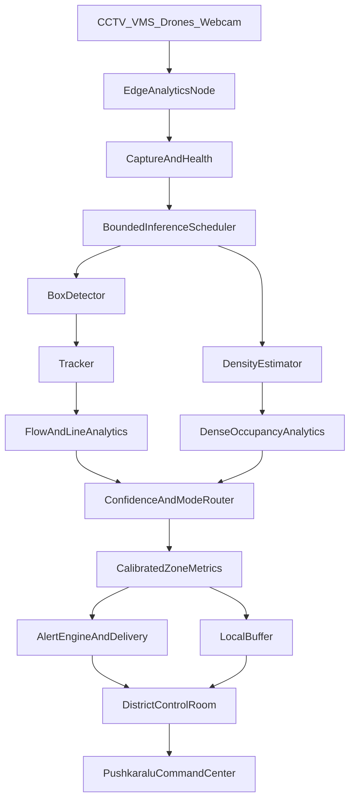

# Godavari Improvement and Production Integration Plan

## Purpose

This document defines the recommended path for turning Godavari into a reliable
crowd-monitoring decision-support system for **Godavari Pushkaralu 2027** without
requiring model fine-tuning at the start.

The published event dates are **June 26 to July 7, 2027** ([East Godavari
District](https://eastgodavari.ap.gov.in/godavari-pushkaralu-2027/)). Public
planning reports have also cited large attendance and ghat-count estimates, but
these figures can change as plans are finalized. Treat estimates such as **8–10 crore
pilgrims**, **approximately 440 ghats**, and **peak-day footfall approaching one
crore** as planning assumptions until each is confirmed by the responsible
government authority ([reported planning figures](https://www.thehindu.com/news/national/andhra-pradesh/ai-to-help-manage-crowd-during-2027-godavari-pushkaralu-in-andhra-pradesh/article71388987.ece)). They motivate a multi-site architecture; they are not camera-count or system-capacity requirements by themselves. The system should
monitor defined operational zones and must not attempt to count the entire event
from one central detector.

This plan prefers:

- Camera placement and calibration over headline benchmark scores.
- Separate detector, density and tracking responsibilities.
- Local edge processing with central metrics and alerts.
- Human-confirmed operational decisions.
- Graceful degradation when a camera, model or network fails.
- Models and checkpoints with clear commercial-use terms.

## Implementation status (reviewed 2026-11-06)

**This document is not complete and should not be deleted.** The current branch
contains a useful single-service foundation, but the production rollout and
several capability acceptance criteria below are still outstanding. The
implementation lists in this document describe delivered foundations, not
proof that the system is validated for operational safety use.

| Capability | Current status | Still needed |
|---|---|---|
| Camera and analytics health | Foundation implemented | Per-camera recovery policy and operational validation |
| Track-based zone counts | Implemented in the live pipeline | Validate continuity and count error on representative footage |
| Alert delivery and storage | Durable webhook outbox, retry, acknowledgement, escalation, attributed closure and JPEG evidence links implemented; SQLite remains canonical, MongoDB Atlas archive is connected, tested, and existing history migrated | Other delivery adapters; evidence retention/access controls for operational deployment |
| Dense-scene handling | Router and optional density adapter implemented | Cleared checkpoint, authorized camera-specific validation, approval before primary use |
| Calibration | API, versioning, world-area metrics and four-point dashboard wizard implemented | Camera-specific validation against surveyed measurements |
| Runtime model management | Registry, audited hot swap, and persistent per-camera detector profiles implemented | Per-camera model-weight policies and production resource controls |
| Image quality | Stale/frozen/quality measurements surfaced | Per-camera thresholds, quality history and incident evidence |
| Scheduling | Bounded queues, batching and stale-frame shedding implemented | Process isolation and production-scale validation |
| Hardware decoding | Backend selection with fallback implemented | Verified NVDEC deployment and equivalence/latency benchmarks |
| Observability | Health APIs, Prometheus metrics and JSON log mode implemented; Docker enables structured logs | Production dashboards and site-specific deployment integration |
| Offline evaluation | Full 2,000-frame CUHK Mall labeled detector-count benchmark completed for YOLO26n and YOLOv8x; results and per-frame CSVs are stored locally under `data/benchmarks/mall/results/` | Representative, authorized ghat footage; tracking, zone, alert-latency and recovery metrics |
| Event-scale architecture and governance | Single-VM Docker deployment path; SQLite plus optional Mongo archive; design documented | Edge/district/central deployment, security controls, benchmark promotion and operational sign-off |

The scale path in this plan and [the production architecture](PRODUCTION_ARCHITECTURE.md)
is still proposed. In particular, MediaMTX/NVDEC worker shards, Triton, shared
event transport, TimescaleDB, SSE fan-out, server-side mosaic, cross-camera
identity handoff, production governance and the Pushkaralu operational pilot
are not implemented by the current single-process application.

Fine-tuning on Pushkaralu footage is intentionally deferred. The first release
uses pretrained models, configuration, calibration, careful routing and
operator-visible confidence. Fine-tuning becomes a later optimization after
legally authorized data and ground truth exist.

## Current application baseline

Godavari is currently a single-process FastAPI service with one camera worker
thread per source:

```text
video source
  -> OpenCV capture
  -> bounded inference scheduler (batch, drop stale)
  -> YOLO person detector, optional detail pass for tiny people
  -> ByteTrack
  -> polygon zone metrics + gate lines
  -> mode router + analytics health
  -> alerts and SQLite history
  -> MJPEG stream (annotated and raw) + WebSocket dashboard
```

Important existing modules:

- [`app/main.py`](../app/main.py) — REST, WebSocket, MJPEG and health endpoints.
- [`app/pipeline.py`](../app/pipeline.py) — camera workers and registry.
- [`app/detector.py`](../app/detector.py) — detector loading, profiles and inference.
- [`app/zones.py`](../app/zones.py) — polygon occupancy and density metrics.
- [`app/health.py`](../app/health.py) — stale, frozen and image-quality detection.
- [`app/scheduler.py`](../app/scheduler.py) — bounded inference queue and batching.
- [`app/calibration.py`](../app/calibration.py) — ground-plane calibration helpers.
- [`app/delivery.py`](../app/delivery.py) — asynchronous webhook alert delivery.
- [`app/metrics.py`](../app/metrics.py) — Prometheus-compatible metrics.
- [`static/app.js`](../static/app.js) — dashboard and canvas overlays.

Already implemented in the current branch:

- Frozen, stale, dark, low-contrast and blurry camera states.
- Track-based zone membership instead of counting every raw detection.
- Optional camera calibration and people/m² metrics.
- Alert webhook delivery with retries and HMAC signing.
- Runtime model listing and switching, with an audit row per swap.
- Balanced and dense detector profiles.
- Bounded inference scheduling with optional micro-batching.
- Decoder backend selection with software fallback.
- `/api/health`, `/metrics` and per-camera diagnostics.
- Initial unit tests for zones, alerts, health and calibration.

Added since this document was written:

- **Detector adapter layer** (`app/adapters.py`): `DetectionResult` with tier and primary
  count, batched `detect_batch`, pluggable model registry (`/api/models`).
- **Mode router** (`app/router.py`): one decision point per frame producing `mode`,
  `estimation_mode`, `selected_count` and a reason, plus analytics health
  (measured / degraded / stale) that is surfaced per camera.
- **Detail pass** (`app/detail.py`): two-tier escalation (2×2 probe, then 3×3 @1280) for
  crowds the full-frame pass cannot resolve, sticky per camera with hysteresis. Recovered
  counts are published as a **lower bound** (`estimation_mode=detector_lower_bound`,
  `≥N` in the UI) and never as a count; capacity alerts are suppressed in that mode in
  favour of one advisory per cooldown.
- **Adaptive tiling** with a merge helper, gated so empty scenes cost nothing.
- **Zone versioning and audit**: every geometry change bumps `zones_version`, writes an
  audit row, and alerts record the version and estimator state they fired under.
- **Analytics**: samples, forecasts, growth and queue signals, area transitions,
  per-camera throughput, CSV export and PDF reports (`/api/analytics`, `/api/reports/*`).
- **Dashboard rebuilt** around one camera: collapsible sidebar (cameras, engine, insights),
  stage with five per-camera views — boxes, actual, heatmap, areas, flow — an **all-views
  mosaic** that shows the same camera five ways at once, a click-to-open tile, and an
  inspector for alerts, the area/gate editor and analytics trust. Areas and gate lines are
  drawn on the video, stored per camera, and survive restarts.
- **Raw frame stream** (`/api/cameras/{id}/stream?raw=1`): the worker keeps the
  pre-annotation frame and encodes it lazily, so boxed and clean pictures of the same
  instant can be shown together.
- **Test suite** covering the router, detail escalation, tiling, zones, alerts, health,
  calibration and the API (30 tests).

This is a roadmap, not a claim that every capability below is implemented. Items
not listed as implemented above remain proposed work and require their own
acceptance checks. Implement and validate them in stages; do not treat the
document as authorization to use unvalidated estimates for safety-critical
decisions.

### Labeled benchmark update (2026-11-06)

The CUHK Mall research dataset provides 2,000 fixed-webcam frames with manual
per-frame head-count annotations. On the Nebius RTX PRO 6000, the existing
person-box counting path substantially undercounted this indoor dense-scene set:
YOLO26n MAE **15.99 people/frame** (WAPE **51.3%**) and YOLOv8x MAE **16.79
people/frame** (WAPE **53.9%**). The larger model was slower and did not improve
counts at the tested confidence and image-size settings. These are detector box
counts compared with head-count labels, so they are useful evidence of a domain
mismatch, not a fair measure of the whole tracked-zone pipeline. Do not tune
operational alert limits from these results.

Dataset archive, extracted frames, a 2 fps review video, benchmark code and
per-frame outputs are kept in `data/benchmarks/mall/`. The dataset is marked
research-only and must not be used commercially. This indoor dataset does not
validate outdoor ghat cameras or safety use. See
[`data/benchmarks/mall/SOURCE.md`](../data/benchmarks/mall/SOURCE.md) and
[`data/benchmarks/mall/results/README.md`](../data/benchmarks/mall/results/README.md).

## Target architecture



The central command center should receive compact metrics, alerts, health
states, thumbnails and selected evidence clips. It should not require every
camera's full-resolution stream to cross the network continuously.

## Model strategy without fine-tuning

### Recommended first production combination

Use a dual-path design, introduced first in offline evaluation and then shadow
mode:

```text
Sparse or moderate crowd:
    current YOLO26 baseline, RT-DETRv2-S/M and/or D-FINE-S/M
    + the existing tracker, evaluated on the same camera clips

Dense or heavily occluded crowd:
    DM-Count as a separate advisory estimate
    + density map and aggregate count

Existing fallback:
    YOLO26n/S/M
```

The exact detector must be selected by benchmark on representative footage.
The model with the highest COCO score is not automatically the best model for
ghat cameras. The listed detector candidates are test candidates, not a claim
that their public checkpoints are already crowd-specialized or will outperform
the current model. Validate checkpoint provenance, code and weight licenses,
supported runtime, and hardware requirements before adoption.

### Detector responsibilities

Box detectors are used for:

- Individual person boxes.
- Line crossing.
- Direction and speed.
- Queue movement.
- Track identities.
- Sparse and moderately crowded zones.

Evaluate candidates in this order, without assuming an accuracy winner:

1. **Current YOLO26n and Dense profile** — establish the measured baseline on
   the actual camera clips. Test larger variants only if target hardware has
   adequate throughput.
2. **RT-DETRv2-S/M and D-FINE-S/M** — compare as general detection candidates;
   check code, checkpoint and dataset terms separately.
3. **RF-DETR-M/L** — optional comparison only after verifying the selected
   model size's terms, runtime support and compute cost.

For tiny people in wide views, also benchmark tiled/region-of-interest
inference. It can improve effective pixel resolution but increases compute and
can create duplicate detections at tile edges; merge behavior must be validated.

Do not replace the current detector solely because another model advertises
higher COCO mAP. Run the same camera clips through every candidate and compare
operational metrics.

### Density-model responsibilities

Use **DM-Count** as the first density-model candidate because it provides a
density map and aggregate count, and its official repository is MIT-licensed.
Confirm the provenance and terms of the exact pretrained checkpoint as well:
the repository license alone does not establish the license of every weight
file or training dataset. It cannot provide persistent identities or reliable
line crossings.

During offline evaluation and shadow mode, use density output for:

- Dense-zone occupancy.
- Aggregate counts.
- Heatmaps.
- Detector under-count warnings.
- Candidate crowd-growth-rate analysis, after temporal stability is measured.

Do not use density output directly for:

- Individual identity.
- Line crossing.
- Person-level tracking.
- Face recognition.

P2PNet is useful for point localization, but its licensing must be cleared
before using it in a production or commercial deployment. It should remain an
optional research adapter until legal approval is documented.

### Mode router

The router must use hysteresis so the system does not switch modes every frame.
The initial router is advisory: model disagreement or an unreliable detector
must reduce the displayed confidence and request operator review. A density
estimate must not become the operational primary count or trigger a critical
alert until it passes camera-specific validation and an authorized owner
approves that use.

```text
SPARSE:
    detector + tracker

MODERATE:
    detector + tracker
    density model runs periodically as a cross-check

DENSE:
    detector tracking is marked unreliable when boxes/track continuity fail
    density estimate is displayed separately as advisory
    aggregate occupancy is marked ANALYTICS_DEGRADED pending review

UNKNOWN:
    camera quality or model confidence is insufficient
    show ANALYTICS_DEGRADED and require operator confirmation
```

The router should consider:

- Number of detections.
- Median detection box height.
- Percentage of low-confidence boxes.
- Track continuity.
- Detector/density disagreement.
- Camera quality.
- Calibrated people/m², only when that camera's calibration is valid and current.

Never sum detector and density counts. Store them separately. Until the density
path has passed its validation gate, do not select it as the operational count;
represent an unresolved estimate explicitly:

```json
{
  "estimation_mode": "degraded_review",
  "detector_count": 38,
  "density_count": 57,
  "selected_count": null,
  "confidence": "low",
  "reason": "high_occlusion; operator review required"
}
```

After validation, an approved per-camera policy may select a calibrated density
estimate for aggregate occupancy. Keep the source, calibration version,
uncertainty, and selection reason visible in every alert and report.

## Model integration design

### Create a detector adapter interface

The current `ModelManager` should become an adapter boundary. Every detector
backend must return the same internal result:

```python
DetectionResult(
    boxes_xyxy,
    confidences,
    class_ids,
    inference_ms,
    model_name,
    model_version,
)
```

Recommended adapters:

- `UltralyticsDetector`
- `RTDETRDetector`
- `DFineDetector`
- `RFDetrDetector`
- `OnnxDetector`
- `TensorRTDetector`

The camera pipeline should depend on `DetectionResult`, not on Ultralytics
objects. This permits benchmarking and deployment changes without rewriting
zones, tracking or alerts.

### Create a density adapter interface

```python
DensityResult(
    density_map,
    total_count,
    zone_counts,
    confidence,
    inference_ms,
    model_name,
    model_version,
)
```

The adapter should:

1. Resize and normalize frames according to the checkpoint requirements.
2. Produce a density map.
3. Integrate the map over calibrated zone masks.
4. Preserve the original image size and coordinate mapping.
5. Report uncertainty and inference timing.

The density model should run at a lower rate than the live video, for example
once every 1–2 seconds in dense mode, while the detector and stream continue
at their operational rates.

### Model registry

Add a model registry containing:

- Model name.
- Backend.
- Version or commit.
- Weight path.
- License.
- Input resolution.
- Expected VRAM.
- Supported device.
- Model task.
- Warm-up status.
- Benchmark results.

Expose:

```text
GET /api/models
PUT /api/models
GET /api/models/{name}/status
```

Model switching must:

1. Stop new inference submissions briefly.
2. Load and warm the replacement.
3. Verify device and output shape.
4. Atomically replace the active adapter.
5. Resume inference.
6. Record the switch in the audit log.

## Camera placement and calibration

This is the highest-impact improvement that does not require fine-tuning.

### Required camera classes

Deploy and configure cameras for separate operational purposes:

- Ghat entry and exit.
- Queue corridors.
- Bathing steps.
- River-edge danger areas.
- Barricade funnels.
- Bridge approaches.
- Medical and emergency lanes.
- Vehicle/pedestrian conflict points.

Avoid using one wide, elevated camera to infer precise occupancy across an
entire ghat. Split it into measurable zones with appropriate views.

### Calibration workflow

For each critical camera:

1. Select four or more points on the ground plane.
2. Enter known distances or real-world coordinates.
3. Calculate and store a homography.
4. Project foot points into ground coordinates.
5. Calculate zone area in m².
6. Set capacity based on usable area and the responsible safety authority.

Store:

```json
{
  "camera_id": "ghat-001",
  "calibration": {
    "image_points": [[...]],
    "world_points": [[...]],
    "homography": [[...]],
    "units": "metres",
    "validated_by": "operator",
    "validated_at": 0
  }
}
```

The dashboard should eventually include a calibration wizard. Until then, use
the calibration API and an operator-approved configuration file.

## Improvements by capability

### 1. Camera health and dead-camera detection

**What it does**

- Detects stale streams.
- Detects frozen frames.
- Detects dark, blurry and low-contrast images.
- Counts decode failures and reconnect attempts.
- Separates `ANALYTICS_DEGRADED` from `SAFE`.

**Why it is preferred**

A dead camera showing zero people is a dangerous false negative. Camera health
must be a first-class safety signal.

**Integration**

- Continue using [`app/health.py`](../app/health.py).
- Update health on every decoded frame, not only inference frames.
- Add camera health to the WebSocket payload.
- Add dashboard status colors and operator acknowledgement.
- Add `/api/cameras/{id}/diagnostics`.

**Acceptance criteria**

- Frozen input is detected within a configured timeout.
- Camera failure is visible in the district dashboard.
- No failed camera is classified as `OK`.
- Recovery clears the degraded state only after several good frames.

### 2. Track-based zone counting

**What it does**

- Counts unique active track IDs inside a zone.
- Prevents repeated detections from inflating occupancy.
- Keeps raw detection count separately.
- Preserves flow and movement analytics.

**Why it is preferred**

Zone occupancy is an operational quantity. Re-counting the same person on every
inference frame makes capacity alerts unstable.

**Integration**

- Continue using [`app/pipeline.py`](../app/pipeline.py).
- Maintain a short membership grace period for briefly lost tracks.
- Expire tracks after a configurable timeout.
- Expose `tracked_count`, `raw_detection_count` and `count_confidence`.

**Acceptance criteria**

- Stable people do not increase the count every frame.
- Zone transitions are tested with recorded sequences.
- Track loss is visible as reduced confidence rather than silently treated as
  ground truth.

### 3. External alert delivery

**What it does**

- Sends alerts to webhooks.
- Retries failed deliveries.
- Signs payloads with HMAC.
- Keeps SQLite as the local source of truth.

**Why it is preferred**

Operators cannot watch every dashboard continuously during a 12-day event.
Alerts must reach the responsible control room.

**Integration**

- Continue using [`app/delivery.py`](../app/delivery.py).
- Add an alert outbox table for durable delivery state.
- Add acknowledgement and escalation.
- Add adapters for webhook, email, SMS, Teams and Slack.
- Include camera, zone, timestamp, severity, evidence thumbnail and model
  confidence.

**Acceptance criteria**

- Temporary network failure does not lose an alert.
- Duplicate delivery is prevented with an idempotency key.
- Operators can acknowledge and close alerts.
- Delivery failures are visible in `/metrics`.

### 4. Dense-crowd counting

**What it does**

- Estimates aggregate crowd count where boxes merge.
- Produces a density heatmap.
- Provides a second estimate for detector under-count.

**Why it is preferred**

Box detectors are fundamentally limited when people become one continuous
occluded texture.

**Integration**

- Add `DensityEstimator` beside `ModelManager`.
- Start with DM-Count and a versioned pretrained checkpoint.
- Keep it advisory until validation on authorized local footage and written
  approval of its operational use.
- Run it periodically in dense zones.
- Aggregate density values over calibrated masks.

**Acceptance criteria**

- Detector and density counts are separately visible.
- Mode changes use hysteresis.
- Alerts identify which estimator produced the selected count.
- No density checkpoint is used for critical alerts before domain validation.
- No detector/density disagreement is silently converted into a confident
  crowd count; show an analytics-degraded state and ask for operator review.

### 5. Ground-plane calibration

**What it does**

- Converts image coordinates into real-world coordinates.
- Reports people/m².
- Makes capacity thresholds more meaningful.

**Why it is preferred**

Pixel area changes dramatically with camera perspective. A fixed pixel-density
threshold cannot be compared safely between cameras.

**Integration**

- Continue using [`app/calibration.py`](../app/calibration.py).
- Add dashboard calibration UI.
- Store calibration version and operator approval.
- Use world-space zone area for density.

**Acceptance criteria**

- Calibrated and uncalibrated modes are clearly distinguished.
- Calibration changes are audited.
- Invalid or stale calibration cannot silently affect alerts.

### 6. Runtime model management

**What it does**

- Lists available models.
- Switches model adapters without restarting the service.
- Reports active model, backend, profile and version.

**Why it is preferred**

Different cameras need different speed/accuracy trade-offs. A river-edge
camera and a low-resolution queue camera should not necessarily use identical
settings.

**Integration**

- Extend [`app/detector.py`](../app/detector.py) into adapter-based loading.
- Add per-camera model/profile configuration.
- Warm models before activation.
- Enforce device-memory limits.
- Record model changes.

**Acceptance criteria**

- A failed model load leaves the previous model active.
- Every result identifies its model version.
- A model switch cannot interrupt an in-flight inference call.

### 7. Image-quality analysis

**What it does**

- Detects darkness, blur, low contrast and frozen content.
- Explains why model confidence is low.

**Why it is preferred**

A model cannot recover information that a camera did not capture. Operators need
to distinguish poor visibility from low crowd density.

**Integration**

- Continue using [`app/health.py`](../app/health.py).
- Display quality metrics in diagnostics.
- Configure thresholds per camera where necessary.
- Add night/rain quality profiles.

**Acceptance criteria**

- Quality warnings do not create crowd alerts.
- Low-quality evidence is attached to operator incidents.
- Camera maintenance teams can query quality history.

### 8. Capture, scheduling and batching

**What it does**

- Separates capture from inference.
- Uses bounded queues.
- Drops old frames rather than accumulating latency.
- Batches compatible frames.
- Prevents one camera from starving others.

**Why it is preferred**

At event scale, stale results are worse than dropped frames. Operators need
current occupancy, not a perfect analysis of video from 30 seconds ago.

**Integration**

- Continue evolving [`app/scheduler.py`](../app/scheduler.py).
- Use per-camera latest-frame queues.
- Add maximum frame age.
- Group requests by backend, device and image size.
- Preserve camera-local trackers and alert engines.

Suggested settings:

```text
CROWD_BATCH_SIZE=4
CROWD_MAX_BATCH_WAIT_MS=8
CROWD_FRAME_QUEUE_SIZE=2
CROWD_MAX_FRAME_AGE_MS=500
```

Start with batch size 1 on CPU and benchmark larger batches on GPU.

**Acceptance criteria**

- P95 frame age remains bounded.
- Queue depth and dropped frames are measurable.
- A slow camera cannot block all other cameras.
- Single-camera behavior remains correct.

### 9. Hardware video decoding

**What it does**

- Moves H.264/H.265 decode work away from CPU where supported.
- Leaves more CPU for orchestration, JPEG and analytics.

**Why it is preferred**

At hundreds of cameras, decoding can saturate the host before inference does.

**Integration**

- Continue using [`app/decoder.py`](../app/decoder.py).
- Prefer GStreamer, FFmpeg or NVIDIA DeepStream on production edge nodes.
- Use NVDEC where supported.
- Retain OpenCV software fallback.
- Report the active decoder per camera.

**Acceptance criteria**

- Hardware and software paths produce equivalent timestamps and dimensions.
- Decoder fallback is visible.
- CPU reduction and end-to-end latency are benchmarked.
- A decoder failure reconnects without losing the camera configuration.

### 10. Observability

**What it does**

- Exposes model, camera, queue, decode, inference and alert metrics.
- Makes incidents explainable after the event.

**Why it is preferred**

Safety systems need evidence. A count without knowing camera health, frame age
and model latency is not operationally trustworthy.

**Integration**

- Continue using [`app/metrics.py`](../app/metrics.py).
- Add labels for camera ID, district, ghat and model version.
- Export `/metrics` to Prometheus.
- Add Grafana dashboards.
- Use structured JSON logs.
- Add audit events for model, calibration and threshold changes.

Minimum metrics:

```text
camera_frames_total
camera_decode_failures_total
camera_frame_age_seconds
camera_frozen_total
camera_quality_score
inference_batches_total
inference_seconds_total
inference_queue_depth
inference_queue_drops_total
detector_count
density_count
zone_occupancy_ratio
alert_delivery_failures_total
```

## Event-scale deployment plan

### Edge node

Each edge node should handle a small camera cluster, for example 8–16 cameras
depending on resolution, model and GPU. The correct number must be measured.

An edge node should include:

- Hardware decoder.
- Inference runtime.
- Local model cache.
- Local alert outbox.
- Local metrics buffer.
- Short evidence-video buffer.
- Network reconnect logic.
- Health endpoint.

### District control room

The district layer should aggregate:

- Zone occupancy.
- Crowd growth rate.
- Camera health.
- Alert severity.
- Open incidents.
- Available emergency routes.
- Operator acknowledgements.

It should allow operators to see selected live feeds without requiring all feeds
to be centrally decoded.

### Central command center

The central system should provide cross-district views, historical analysis,
resource coordination and audit reports. It should not be the only place where
alerts can be generated.

If central connectivity fails, edge and district control rooms must continue to
operate.

## Data protection and operational governance

The system should be designed around counting and safety analytics, not
identification.

Required controls:

- No face recognition.
- No identity database.
- Blur faces where evidence video is retained.
- Purpose-limited analytics.
- Clear CCTV and AI-analytics notices.
- Role-based access.
- Encryption in transit and at rest.
- Retention limits for raw video.
- Audit logs for access and exports.
- Documented incident and breach procedures.
- Operator review for critical decisions.

Review the [NDMA crowd-management guide](https://ndma.gov.in/sites/default/files/PDF/Reports/managingcrowdsguide.pdf)
and applicable Indian data-protection requirements before deployment.

## Evaluation plan without fine-tuning

Create a benchmark set from authorized footage before selecting the production
model. Do not use only public COCO or crowd-dataset scores.

Sample:

- Sparse queue.
- Moderate queue.
- Dense bathing area.
- Overhead packed crowd.
- Night scene.
- Backlit scene.
- Rain or haze.
- Camera movement or compression.
- Camera freeze and network interruption.

Measure:

- Count MAE.
- Relative zone-count error.
- Small-person recall.
- Occluded-person recall.
- False-positive rate.
- Track continuity.
- Line-crossing error.
- Alert latency.
- P95 frame age.
- Inference FPS.
- CPU and GPU memory.
- Camera recovery time.

Required benchmark outputs:

```text
model_name
model_version
backend
camera_id
scene_type
detector_count
density_count
manual_count
absolute_error
inference_ms
end_to_end_fps
frame_age_ms
gpu_memory_mb
```

Use confidence bands and operator review. Do not convert a benchmark result
directly into a public safety guarantee.

### Promotion gate for operational counts

Before any new detector or density estimate can drive occupancy alerts, the
camera owner and safety lead should set acceptance limits for count error,
false alarms, missed threshold crossings, alert latency, and required camera
availability. Evaluate those limits separately for each camera class and
relevant conditions (day/night, weather, view angle, and crowd density). Keep a
held-out set of manually reviewed clips. If a camera is out of distribution,
the stream is stale, or model estimates disagree beyond the approved tolerance,
show `ANALYTICS_DEGRADED`; do not interpret the disagreement as a safe zone.

Avoid a universal people-per-square-metre alarm threshold. Density limits depend
on geometry, movement, crowd behavior, usable area, and the responsible safety
authority's operating plan. Calibrated density is an input for trained
operators, not a stand-alone crush-risk measurement or automatic intervention
rule.

## Recommended rollout timeline

### Stage 1: Platform hardening

- Confirm camera inventory, operational ownership, target hardware and network
  constraints.
- Keep the current YOLO path as the reference implementation; add only the
  thin adapter/evaluation interface needed to compare models without changing
  tracking, zones or alert behavior.
- Complete health, diagnostics and metrics dashboards.
- Add durable alert outbox and acknowledgement.

### Stage 2: Offline benchmark

- Export a consented, representative, manually counted evaluation set.
- Benchmark the current YOLO26 profiles first; then add RT-DETRv2/D-FINE only
  if runtime and hardware support make the comparison practical.
- Add DM-Count as an offline evaluator, with its output kept separate from the
  live operational count.
- Run all candidates on the same clips.
- Select per-camera candidates only when they meet the promotion gate below.

### Stage 3: Shadow mode

- Run detector and density paths in parallel.
- Do not allow automatic critical interventions.
- Compare outputs with operator observations.
- Tune thresholds and mode transitions.
- Keep critical alerts on the approved existing estimate; show new estimates
  with model source and uncertainty for comparison.

### Stage 4: Controlled pilot

- Deploy to a small number of representative ghats.
- Test day/night and network failure.
- Run evacuation and congestion drills.
- Validate alert ownership and response time.
- Require sign-off against the promotion gate before any new model estimate
  influences operational occupancy alerts.

### Stage 5: Scale-out

- Add edge nodes by district.
- Integrate VMS and control-room workflows.
- Freeze model versions and calibration.
- Establish on-call support and replacement procedures.

### Stage 6: Event operations

- Change control for model and threshold updates.
- Continuous camera-health monitoring.
- Daily operational review.
- Incident evidence preservation.
- Post-event model and system evaluation.

## Final recommendation

For the first no-fine-tuning deployment:

```text
Primary sparse/moderate detector:
    Existing YOLO26 baseline; benchmark RT-DETRv2-S/M and D-FINE-S/M

Operational fallback:
    Existing YOLO26 profile

Dense-crowd companion:
    DM-Count with a pretrained checkpoint

Tracking:
    ByteTrack or BoT-SORT only where boxes are reliable

Measurements:
    Calibrated zone occupancy, people/m², flow and growth rate

Deployment:
    Hardware-decoding edge nodes with local alerting

Safety policy:
    Unvalidated density stays advisory; disagreement and camera failure become
    explicit degraded states requiring operator review
```

The first production milestone should be a validated pilot, not a claim that
one model can accurately count every person across the entire festival. Camera
coverage, calibration, health monitoring, independent density cross-checking,
low-latency alerts and trained operators will contribute more to safety than
changing from one detector family to another without local validation.

## Reference sources

- [Government of Andhra Pradesh — Godavari Pushkaralu 2027](https://godavaripushkaram2027.ap.gov.in/)
- [East Godavari District — Godavari Pushkaralu 2027](https://eastgodavari.ap.gov.in/godavari-pushkaralu-2027/)
- [The Hindu — AI crowd management plans](https://www.thehindu.com/news/national/andhra-pradesh/ai-to-help-manage-crowd-during-2027-godavari-pushkaralu-in-andhra-pradesh/article71388987.ece)
- [NDMA — Managing Crowds: A Guide](https://ndma.gov.in/sites/default/files/PDF/Reports/managingcrowdsguide.pdf)
- [RT-DETR official repository](https://github.com/lyuwenyu/RT-DETR)
- [D-FINE official repository](https://github.com/Peterande/D-FINE)
- [RF-DETR official repository and license notes](https://github.com/roboflow/RF-detr)
- [DM-Count official repository](https://github.com/cvlab-stonybrook/DM-Count)
- [P2PNet official repository](https://github.com/TencentYoutuResearch/CrowdCounting-P2PNet)
